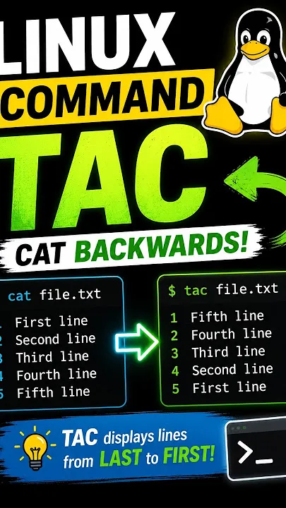

# 镜中之猫：Linux中的tac命令

Linux 世界里有一只不太常见的“猫”，叫 tac。执行 tac file.txt，文件最后一行会出现在最前面，倒数第二行紧随其后，整个文件就这样从尾到头颠倒输出（图2）。

tac 不像 tail 那样只是取文件末尾几行，而是把整个文件的顺序反转。偶尔可以配合 head、grep 等命令使用，让最新的日志行出现在最上面，稍稍提升易读性。

tac 这个命令的名字很有意思。把 cat 放在镜子前，看到的正是 tac。而它的行为也像是 cat 照了镜子：cat 把内容从头到尾输出，tac 则把内容从尾倒着反转输出。

cat 这个命令是 concatenate（连接、拼接）的缩写，和“猫”本没有关系。不过，Linux 世界巧妙地利用了这个文字游戏，顺势养出了各种各样的“猫”——长着翅膀、会高亮代码的 batcat，会解压压缩文件的 zcat，会连接网络的 netcat（nc），会消费 Kafka 消息的 kafkacat（kcat），还有专门把终端输出变成彩虹色的 lolcat。
