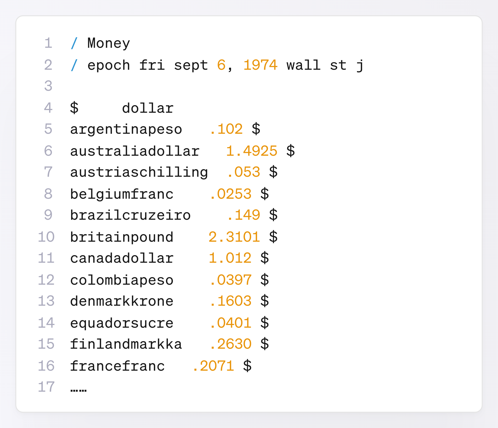
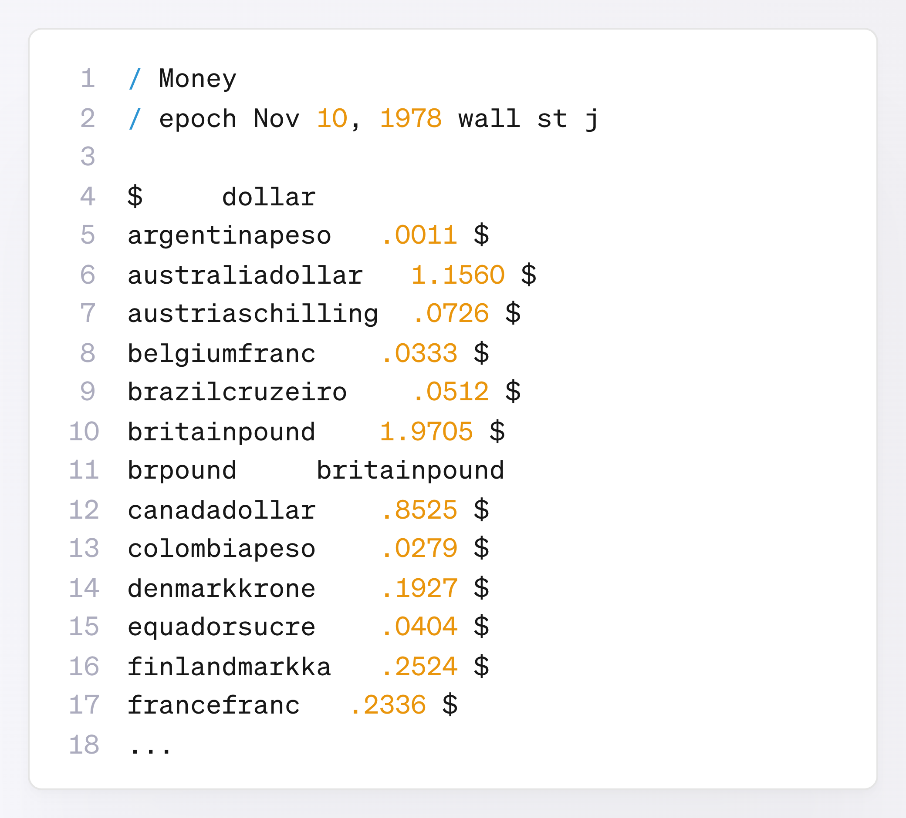
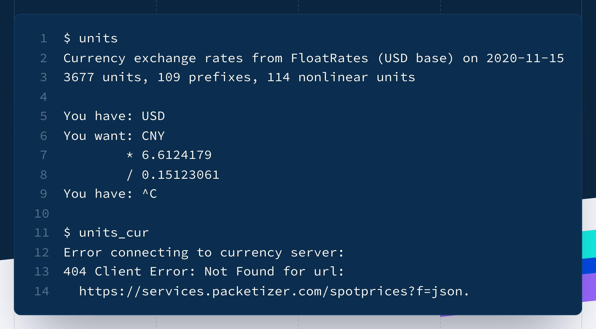

# 藏在Unix源代码里的两张汇率表

这两张汇率表，一张来自 1975 年 5 月发布的 Unix V6，汇率冻结在 1974 年 9 月 6 日；另一张来自 1979 年 1 月发布的 Unix V7，汇率冻结在 1978 年 11 月 10 日。





它们都是给 units 命令用的。units 是一个交互式单位换算器，启动后一问一答——你告诉它想把什么单位换成什么，它就报出换算系数：

```
you have: USD
you want: CNY
        * 6.6124179
        / 0.15123061
```

如图 3 所示，输出里以 ”*“ 开头的那行表示乘以这个数就能得到目标单位，以 ”/“开头表示除以这个数得到目标单位，两者互为倒数。

两张汇率表都写在 /usr/lib/units 这个数据文件里。表头的 epoch 是时间基准，wall st j 表示《华尔街日报》（Wall Street Journal）。

那年头联网不方便，汇率就只能写死。使用手册留下一句敬告：Don't base your financial plans on the currency conversions.（别拿这些汇率做财务计划。）

图 3 是在现代 Linux 上运行 `units` 命令的截图。今天的 GNU 的 `units` 可以使用附带的 `units_cur` 脚本联网抓取最新汇率、更新本地货币表，但是这个脚本报错了。

