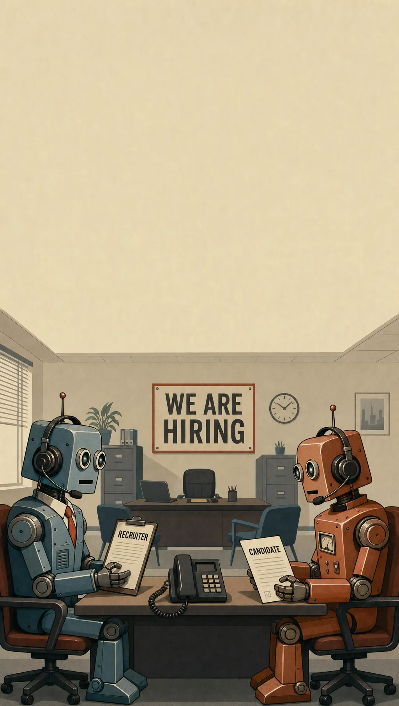

# “后续会有招聘人员联系你”，当AI招聘遇上AI求职

Christopher 人到中年，又赶上裁员潮，半年里集中投了大约 700 份简历，大多石沉大海。

他接到了 5 次来自同一家 IT 公司打来的电话，只不过对面是个 AI 招聘员。每次，AI 招聘员都会例行询问职业背景、项目经历等问题，最后说一句“如果符合条件，后续会有招聘人员联系你”。然后就没有然后了。

第 5 次挂断电话后，Christopher 决定以 AI 对付 AI。他把自己的信息喂给 ChatGPT Voice，让它替自己接电话。结果，两个 AI 开始了一场 10 多分钟的第 6 轮“初试”。AI 招聘员说“很高兴和你交流”，ChatGPT 夸贵公司的流程“清晰直接”。最后 AI 招聘员照例：“如果符合条件，后续会有招聘人员联系你”。当然，依然没有什么好事发生。

Christopher 后来又造了个“完美的面试候选人”，还给它取了个名字“Don Dickner”，并把简历信息全塞给了“他”。AI 招聘员的电话又打来了，这次两个 AI 聊了 23 分钟。结果仍是一句：“如果符合条件，后续会有招聘人员联系你”。