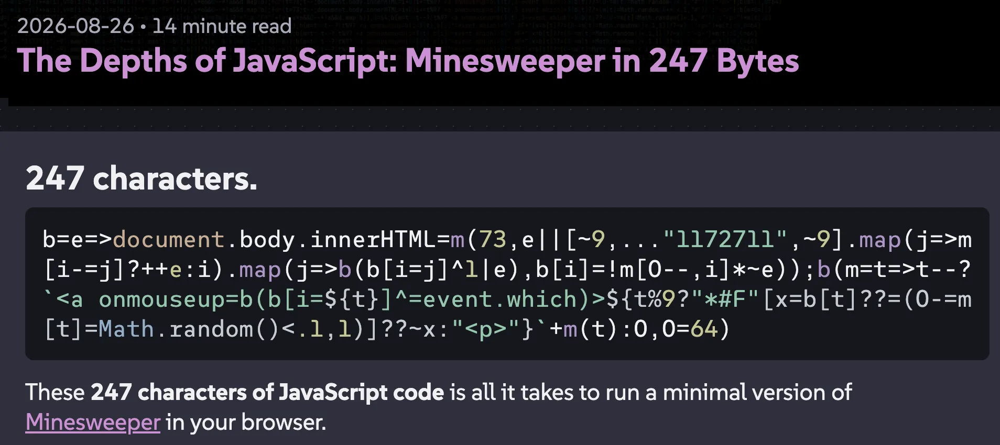
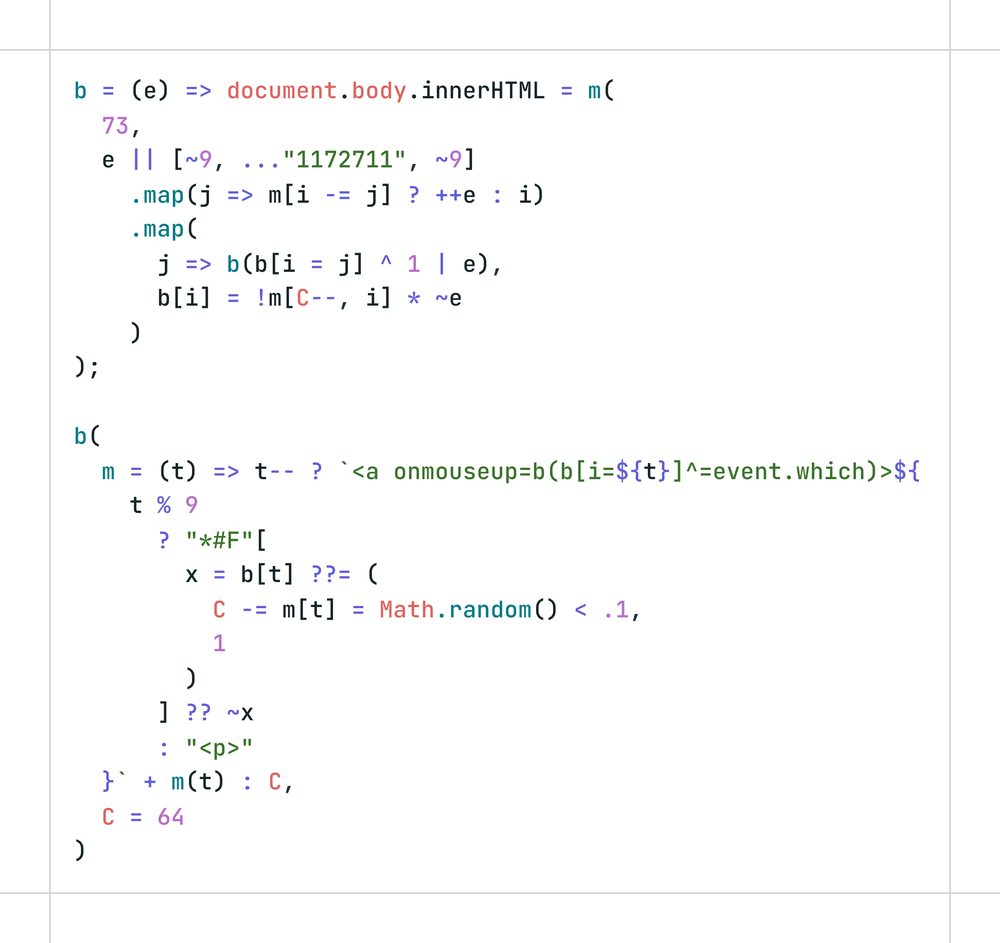

# 仅247个字符的JavaScript代码实现了扫雷：code golf的极限压缩

你相信吗？一个能（凑合）玩的扫雷游戏——8×8 方阵、随机地雷布局、左键开格、右键插旗、无雷区域自动展开——总共只需要 **247 个字符** 的 JavaScript 代码。

不是 247 **行**，而是 247 **个字符**。贴出来就这一坨：



这段代码竟然能直接塞进浏览器跑起来。

> todo 插入视频演示

这种“用最少的字符完成功能”的技术（把戏）叫 **code golf**。名字来自高尔夫，就像杆数越少越好一样，代码也是越短越好。规则简单粗暴，字符数就是胜负的唯一裁判。

“247 字符扫雷”的作者 yui 几年前只是图个乐，一晚上把“扫雷”压缩到 658 个字符，几周后又打磨到 399 个字符，随后感觉已经再无进步空间便搁置了。又过了几个月，没想到翻出来随手一改，发现还能更短，便一发不可收拾，最终定格在 247 个字符。

稍稍格式化一下代码，可以看到整段代码只是定义了两个函数：



- **`b()`** 函数控制游戏逻辑，处理点击事件、开格、插旗
- **`m()`** 函数绘制界面，递归画出 8×8 方阵的每个格子，以及最后一行还剩多少安全格子的计数器

而 `m()` 本身，是在第一次调用 `b()` 时定义的。

扫雷游戏需要记录两份数据（状态）：玩家看到的盘面，上面有数字、旗子、地雷；以及真实的雷区分布。常规方法是创建 2 个数组，但这里 一个都没创建，而是直接拿 `b()` 和 `m()` 这两个函数当数组用。这里利用了 JavaScript **函数**也是对象、**可以按下标存取值的特性**。代码里 `b[t]` 存储棋盘上第 `t` 个格子的状态，`m[]` 存储地雷布局，`t` 从 `73` 递减到 `0`，正好铺满一维的 8×8 棋盘。

等等，`73 - 8 × 8 = 9`，怎么还多出 9 个格子？答案藏在 `t % 9 ? ... : "<p>"` 这一处判断里。8 × 8 是 64 个格子，但每行末尾还偷偷塞了一个“隐藏列”——`<p>` 作为换行符，分隔上下两行，8 行就是 8 个，再加上递归走到 `t=0` 时的那一个终止标记，`64 + 8 + 1 = 73`，刚刚好。

顺带一提，为了减少字符数，连闭合标签都省了。浏览器规定， `<a>` 不能套 `<a>`、`<p>` 不能套 `<p>`，遇到新标签就会自动结束，于是整段 HTML 一个 `</a>` 或 `</p>` 都没有。

类似的巧思随处可见，比如配合 `??=` 运算符和“赋值可当作表达式”的写法，初始化雷区、扣减剩余安全格数（初始值为 `64`）全挤在一行里：

```js
x = b[t] ??= (C -= m[t] = Math.random() < .1, 1)
```

`Math.random() < .1` 表示每格有 10% 的概率有地雷，布尔值 `true`/`false` 则被转换成数字 `1/0`，靠类型转换偷偷完成"有雷计数器 `C` 就减 `1`"。
