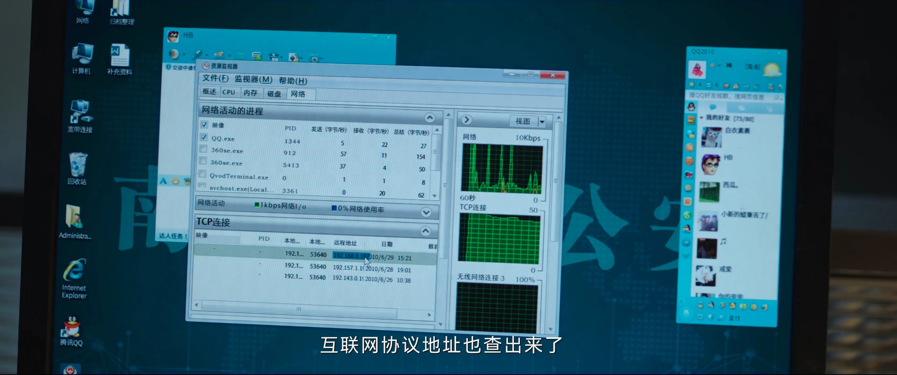
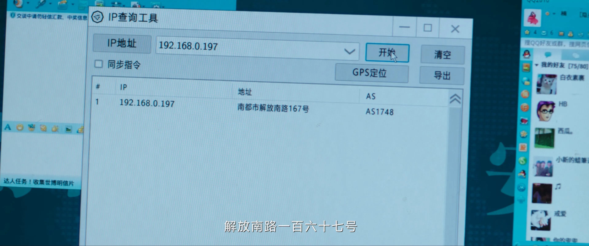
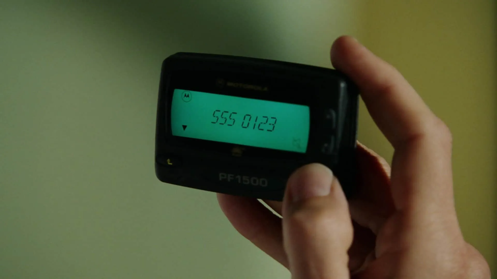
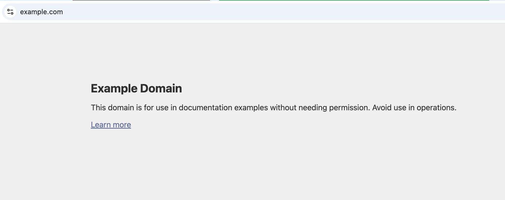

#  拨不通的电话号码，连不上的IP地址

最近在看悬疑剧《尘封十三载》。有一幕是警方登录了受害人的 QQ，用 Windows 自带的“资源监视器”翻出了一条这个 QQ 号几天前建立的 TCP 连接（没错，是几天前），然后顺着 `192.168.0.197` 这个“**远程**“IP 地址，锁定了嫌疑人当时的行踪，在一家网吧。

嫌疑人的 IP 地址 `192.168.0.197` 显然是个私有 IP 地址，根本不会出现在公网的路由表里。更逗的是，这个 IP 地址还挂了个 **AS 号**：`AS1748`。

互联网其实是由许多“**自治系统**”（Autonomous System，AS）联结起来的。自治系统可以是网络运营商、机构、企业或学校，它们各自管理自己的网络。每个自治系统都拥有全球唯一的 AS 号，依靠一种叫 BGP 的路由协议对全网广播：“我是谁、能到哪”。剧里给的 AS 号 `AS1748` 是属于芬兰航空的。

不过这不是今天的正题。今天想聊的是通信系统里那些专门留着“造假用”的**虚构号码**。

常看美剧的朋友可能早就发现了，剧里的人打电话，号码似乎总是 **555** 开头。

在影视作品里，电话号码也是一种需要精心设计的“道具”。为了避免观众真的打给现实中的用户，美国影视行业长期以来使用以 **555** 开头的虚构号码。其中有些号码还因为反复出现在影视作品中，成了观众熟悉的“明星号码”。

一个有趣的例子是，2003 年的电影《Bruce Almighty》（《冒牌天神》），影院上映时，电影里上帝留给 Bruce 的电话号码是一个真实号码。电影上映后，现实中的某个“倒霉蛋”开始频繁收到大量观众打来的电话。于是家庭录像和电视版本将其改成了 **555-0123**。这个号码属于专门**保留给虚构作品使用的 555-0100～555-0199 号码段**。

不过也有不满足于虚构号码的作品。《绝命毒师》里“Better Call Saul”的广告中给了一个新墨西哥州的电话号码：(505) 503-4455——这不是“道具”，是真实注册的号码，据说打过去会听到 Saul 的录音留言。这不是避免“伤及无辜”，而是盼着观众真打过去的彩蛋。

就像 555 电话号码一样，IP 地址中其实也有专门预留的“假地址”。为了避免教材中随手写的公网 IP 地址正好落在某家公司的服务器上，**RFC 5737 文档**里划出三个专用网段：

* 192.0.2.0/24      TEST-NET-1
* 198.51.100.0/24   TEST-NET-2
* 203.0.113.0/24    TEST-NET-3

RFC 5735 文档中明确写道：这些地址**不应该**出现在公共互联网上。所以技术文档里的 `203.0.113.42`，和电视剧里的 555-0123 是一个道理，都属于特意挑选的不伤及无辜的虚构号码。

不只是电话号码和 IP 地址，域名也有同款的**虚构域名**。RFC 2606 定义的 `example.com`、`example.net` 等，外加 `.test`、`.invalid`、`.localhost` 整片保留顶级域，都是给示例用的。不过，不像 555 电话打不通，确实是可以访问 `www.example.com` 的，但只能看到一个简陋的页面。

有意思的是，影视行业早就把 555 普及成了大众一眼就能认出的“假号码”；可 `203.0.113.x` 这种假公网 IP 地址似乎还很陌生，想找一部用到了 TEST-NET 网段的戏都难。倒是 `192.168.x.x` 这种**内网地址**经常被搬上银幕。

🔚