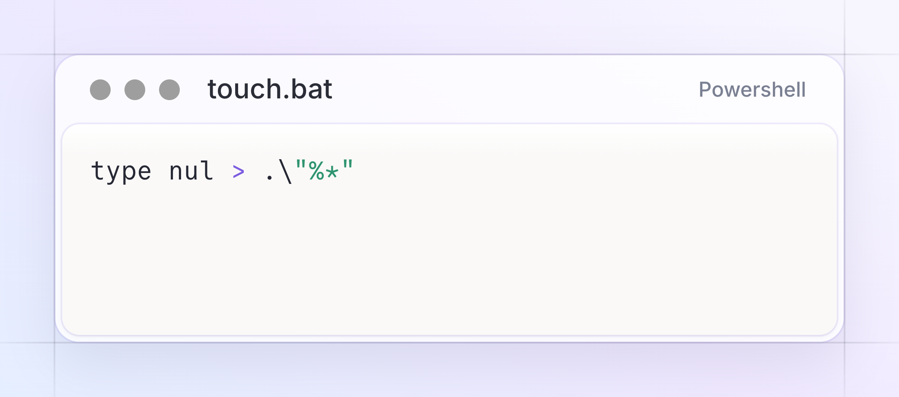

# 一行DOS命令“模拟”Linux的touch命令

在 Windows 上，把这行 DOS 命令写进一个批处理文件 touch.bat，就得到一个伪 touch 命令：

```bat
type nul > .\"%*"
```



只需 C:\> touch file.txt，就能新建一个空文件 file.txt。不过这个伪 touch 命令有两个和 Linux 的 touch 很不一样的地方。

第一个坑：一次只能新建一个文件。“`%*`”表示接住全部参数，执行 `touch a.txt b.txt`，`%*` 会展开成 `a.txt b.txt`，整个被当成一个文件名。于是，你得到的不是两个空文件，而是一个叫“`a.txt b.txt`”的文件。

第二个坑更危险：这个伪 touch 命令会把已存在的文件清空。而 Linux 的 touch 只是更新已有文件的修改时间，不会清空内容。  

所以这顶多算是“创建一个空文件”的小技巧，不算真正的 touch。而且你知道吗，创建新文件原本只是 touch 命令的副作用。
