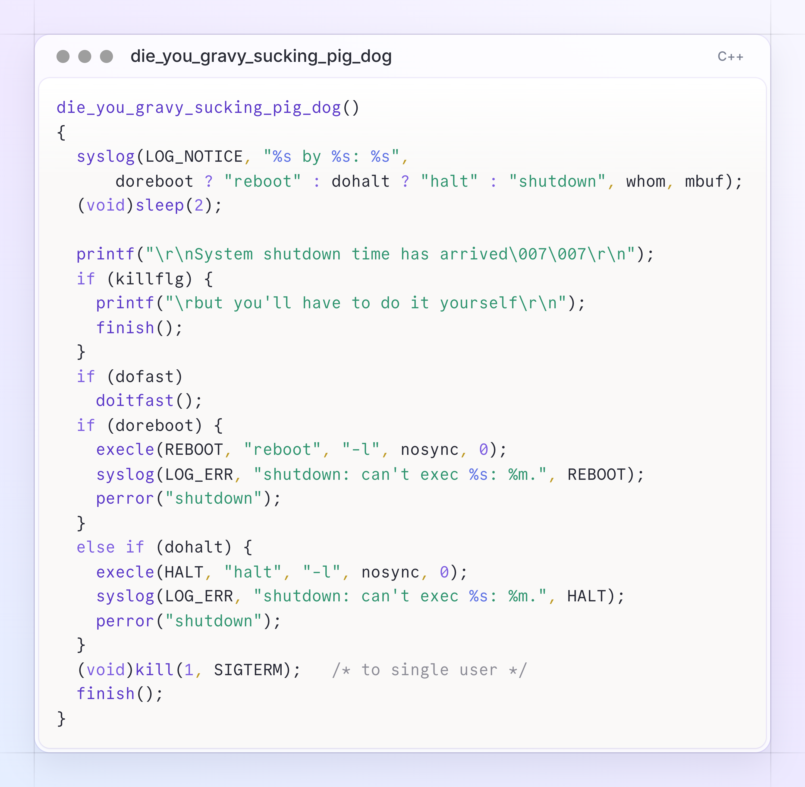

# BSD Unix中粗俗的函数名：去死吧，你这舔肉汁的猪狗！

1987 年前后，加州大学伯克利分校的计算机系统研究组在开发 BSD Unix 时，有程序员起了个相当不客气的函数名：`die_you_gravy_sucking_pig_dog()`，直译过来就是：“去死吧，你这舔肉汁的猪狗！”



名字听着像是在骂人，但函数干的活儿倒是正经：执行关机或重启操作。当关机倒计时归零后，先把相关信息写进系统日志，记录是谁发起了关机或重启；接着让终端响铃两声，通过两个 ASCII 响铃字符 `\007`，宣布“死亡时间”到了，最后真正执行关机或重启。

如果用户加上 `-k` 参数（`killflg`），启用所谓的“just kidding”（开玩笑）模式，系统就不会真的关机。两声铃响后，屏幕上显示一句“but you'll have to do it yourself”，“你得自己动手”。

这个函数名毫不掩饰作者对“不打招呼就关掉我机器”这种行为的鄙夷——行啊，要关机啊，那你去死吧，你这舔肉汁的猪狗！

🔚

```c
die_you_gravy_sucking_pig_dog()
{
	syslog(LOG_NOTICE, "%s by %s: %s",
	    doreboot ? "reboot" : dohalt ? "halt" : "shutdown", whom, mbuf);
	(void)sleep(2);

	printf("\r\nSystem shutdown time has arrived\007\007\r\n");
	if (killflg) {
		printf("\rbut you'll have to do it yourself\r\n");
		finish();
	}
	if (dofast)
		doitfast();
	if (doreboot) {
		execle(REBOOT, "reboot", "-l", nosync, 0);
		syslog(LOG_ERR, "shutdown: can't exec %s: %m.", REBOOT);
		perror("shutdown");
	}
	else if (dohalt) {
		execle(HALT, "halt", "-l", nosync, 0);
		syslog(LOG_ERR, "shutdown: can't exec %s: %m.", HALT);
		perror("shutdown");
	}
	(void)kill(1, SIGTERM);		/* to single user */
	finish();
}
```