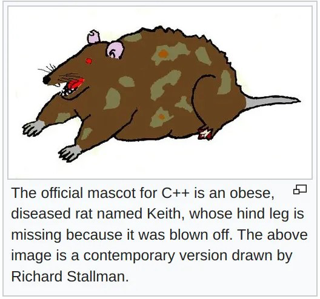

# C++的吉祥物，是一只断了腿的肥老鼠？

程序员圈子里流传着一张图：一只又肥又丑的棕色老鼠。旁边的说明煞有介事：C++ 的官方吉祥物是一只名叫 Keith 的老鼠，丑陋、患病、肥胖，后腿还断了。这是自由软件运动发起人、GNU 项目创始人 Richard Stallman 绘制的。甚至还有传言说，Stallman 自己也承认不擅长画画，所以才画出了这么一只老鼠。

听起来挺像那么回事，可惜故事是编的。C++ 根本没有什么官方吉祥物，也没有叫 Keith 的老鼠。这套说辞来自恶搞百科。只是这只老鼠在程序员圈子里传来传去，假话也就有了几分真相的模样。

不过，还真有一只“恶心”的动物，出现在 Ubuntu 的版本代号里。2004 年 10 月，Ubuntu 发布了第一个正式版本 4.10，代号叫 Warty Warthog，直译过来就是“长疣的疣猪”。

据 Ubuntu 创始人 Mark Shuttleworth 回忆，当时团队在悉尼的一艘渡船上聊天，定下了一个目标：6 个月内做出第一个版本。时间紧，任务重，想把每个细节都打磨得漂漂亮亮，恐怕不现实。于是，一头长满疣的疣猪成了 Ubuntu 的开场主角。后来每个版本都沿用“形容词 + 动物”的叫法，一直用了二十多年。