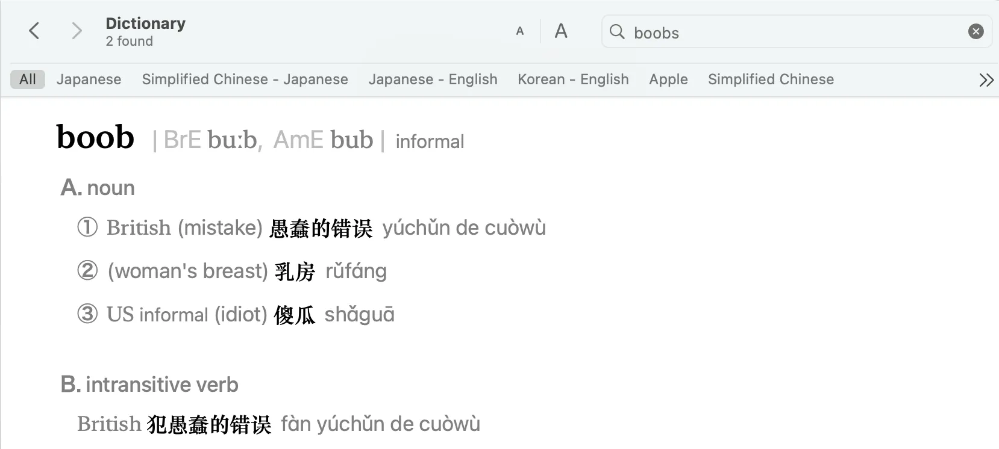
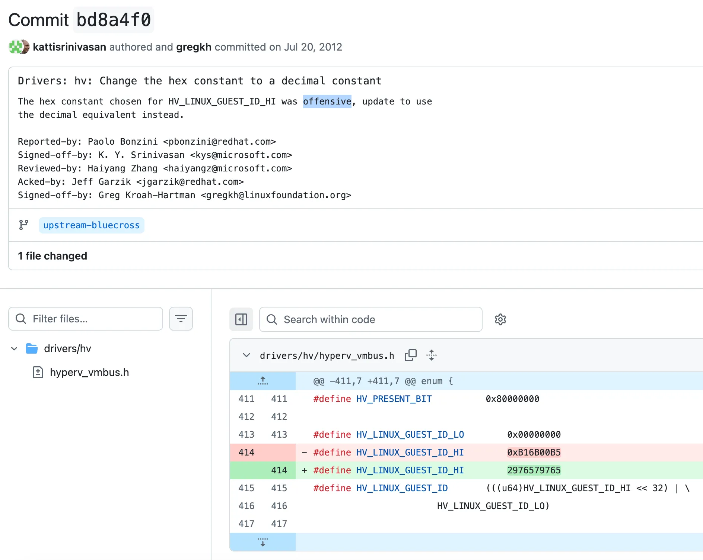

# IT术语中的低俗词语③：微软曾在Linux内核里藏了个低俗玩笑

看看下面这行代码，你能读出什么？

```c
#define HV_LINUX_GUEST_ID_HI 0xB16B00B5
```

如果把 `6` 当成 `G`，`5` 当成 `S`，`1` 和 `0` 分别当成 `I` 和 `O`，十六进制数 `B16B00B5` 就变成了 **BIG BOOBS**。



2012 年 7 月，一位 Linux 内核开发者在邮件列表讨论**微软的虚拟化平台 Hyper-V** 的驱动代码时，注意到了这个十六进制数。

这个数字是 Linux 虚拟机的“身份”，用来向 Hyper-V 报告“我是谁”。那么，问题来了：好端端的一个 ID，为什么偏偏选了这么个拿女性身体开玩笑的“字符串”？

事情很快有了后续。微软工程师在邮件列表中道歉，态度诚恳，感谢社区指出问题，并表示已经提交补丁，修复了这个冒犯性的字符串。只是修复方法嘛……

提交记录的标题是 `Drivers: hv: Change the hex constant to a decimal constant`，改动只有一行：

```diff
-#define HV_LINUX_GUEST_ID_HI 0xB16B00B5
+#define HV_LINUX_GUEST_ID_HI 2976579765
```



看出来了吗？数值本身是一点没变，**只是从十六进制改成了十进制**。

🔚

IT术语（黑话）自有其传承。早期黑客文化中，讽刺与反叛几乎是一种身份象征，不正经，才够格。调侃、低俗乃至粗口风格的俚语成为黑客社群的通用术语，其中一些词语还沉淀到了官方文档和源代码中。

https://github.com/GZR-Kernels/kernel_google_trm-4.9/commit/bd8a4f06d0310326f89fd58fed74f2db8e345056

