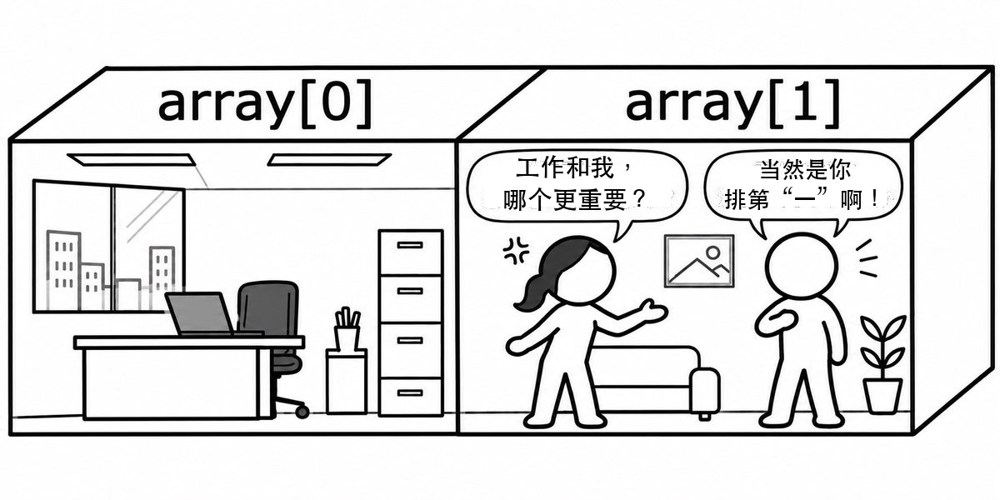

# 漫画 女朋友：工作和我，哪个更重要？

男朋友答：当然是你排第“一”啊！

可是你看，工作在 0 号位置，“她”在 1 号位置。

那数组的下标是从 0 开始好，还是从 1 开始好呢？

1982 年 8 月，图灵奖得主 Edsger W. Dijkstra 写过一篇笔记：《Why numbering should start at zero》（为什么编号应该从零开始）。

他的论证从一个看似简单的问题出发：如何表示一段连续的整数？如 2, 3, ..., 12。

他认为，最好采用“左闭右开”的区间表示法，也就是：2 ≤ i < 13。这种表示法有 2 个好处：

1️⃣ 区间长度等于上下界之差。上面这段整数的长度正好是 13 − 2 = 11。

2️⃣ 相邻区间可以无缝衔接。例如，2 ≤ i < 13 和 13 ≤ i < 20，两个区间既不重叠，也没有遗漏。