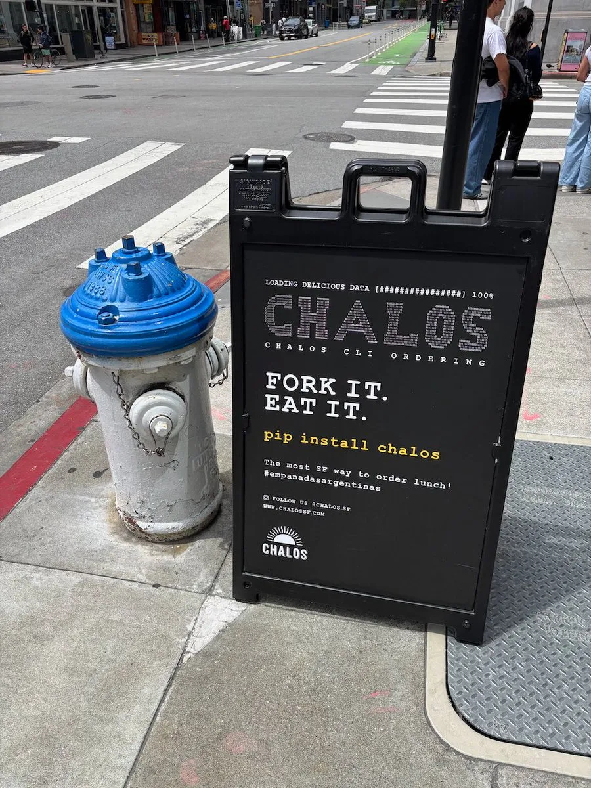
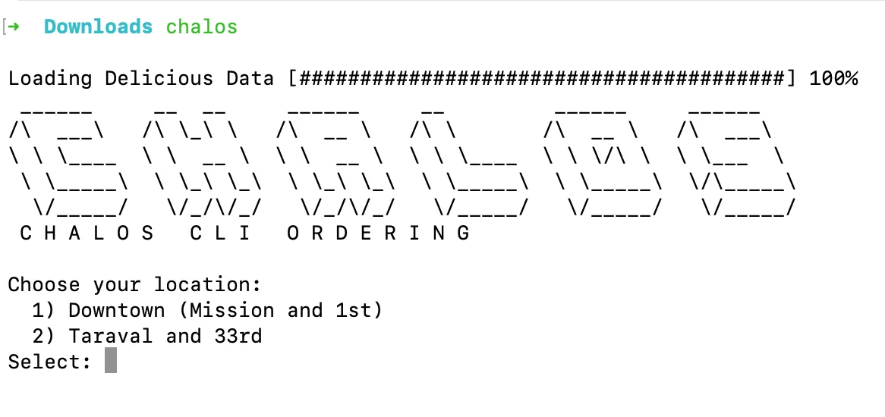
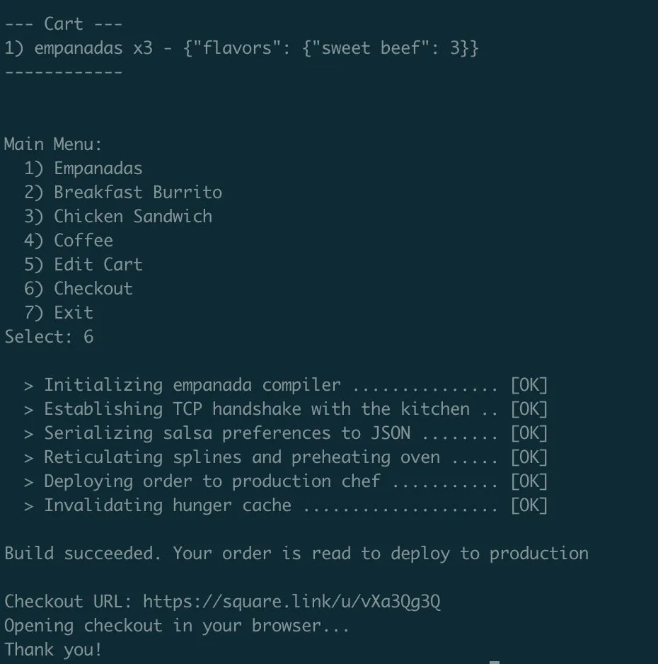

# 想在旧金山吃个阿根廷馅饼，得先pip install？

旧金山 Salesforce 大厦脚下，有一家卖阿根廷馅饼的小店，名叫 CHALOS。

店门口立着一块黑色招牌，上面写的不是“欢迎光临”，也不是“今日特价”，而是“**FORK IT. EAT IT.**”。下面还有一行命令：

```bash
pip install chalos
```



路过的 Python 程序员大概会愣一下：怎么就吃个馅饼，还得先装个 Python 包？（要是路过的不是程序员，又会怎么想呢？）

去 PyPI 上一搜，还真有个 `chalos`，简介只有一句：

> Real hackers order empanadas from the CLI.
> 
> 真正的黑客，都在命令行里点馅饼。

这个点餐工具的作者叫 Willy，他在过去几年里经常光顾 CHALOS，渐渐和店主熟悉起来。有一次，他开玩笑说，要给他们做个命令行点餐工具。

店主并没有拿**我们有“服务员端”盘子，不需要“客户端”**，这样的理由拒绝 Willy。

## 装上之后

用 `pip install chalos` 安装好之后，在终端里敲下 `chalos`，按下回车，屏幕上就会先跑出一条“Loading Delicious Data”进度条，接着显示一个大大的 ASCII 字符画 logo。



点餐流程如下：

1. 选择门店
2. 检查门店当前是否营业
3. 从 AWS Lambda 获取实时菜单，售罄的菜品会自动隐藏
4. 在终端里选择馅饼、早餐卷饼、鸡肉三明治或咖啡
5. 生成结账链接，自动打开浏览器付款

最好玩的是结账那一步，终端会一行一行地打出：

```
> Initializing empanada compiler ............ [OK]
> Establishing TCP handshake with the kitchen [OK]
> Serializing salsa preferences to JSON ..... [OK]
> Reticulating splines and preheating oven .. [OK]
> Deploying order to production chef ........ [OK]
> Invalidating hunger cache ................. [OK]
```



翻译过来就是：

> 初始化馅饼编译器  
> 与后厨建立 TCP 握手  
> 将辣酱偏好序列化为 JSON  
> 生成样条曲线，同时预热烤箱  
> 将订单部署给生产环境的厨师  
> 清空饥饿缓存

其中，第 4 句里的“Reticulating splines”出自 1993 年的《模拟城市 2000》，是游戏在创建新城市时，加载画面里闪过的一句话。

chalos 命令行里的这几步当然都是假的，不过是一段 `time.sleep()` 动画。最后还会显示：

```
Build succeeded. Your order is read to deploy to production
```

仔细一看，单词 `ready` 少了个 `y`。

整个命令行工具只有一个文件 `chalos.py`，将近 500 行，里面还有几个小细节：

- 命令行参数 `--fast` 的作用是，当你真的很饿的时候，跳过动画，尽快看到菜单。
- 源码里把馅饼的可选购买数量写死成了 `amounts = [1, 3, 6, 13]`，一次只能选择 1 个、3 个、6 个或 13 个。这里的一打不是 12 个，而是 13 个，可能是因为英语里有个比普通一打多给 1 个的说法，叫 baker's dozen，也就是“面包师的一打”。
- 代码里判断店铺是否营业时，使用的是写死的 PST 时间，也就是太平洋标准时间，比 UTC 慢 8 小时。但加州也实行夏令时，这时旧金山使用的是 PDT（太平洋夏令时间，UTC−7）。代码把 UTC−8 写死会导致一到夏天，店铺早上 8 点开门，你却得等到 9 点才能用这个脚本点餐；晚上打烊后，脚本反倒还会多给你 1 小时的点餐时间。

***

说实话，`pip install chalos` 一点也不比打开网页点餐快。你得会用终端，得装好 Python 和 pip，还得耐着性子看完一段假装在“编译馅饼”的动画。

但它本来也不是为了让点餐更快，而是给那些整天泡在终端里的人准备的一个玩笑，甚至还能让他们有点小小的自豪感：“嘿，我知道怎么点餐！”